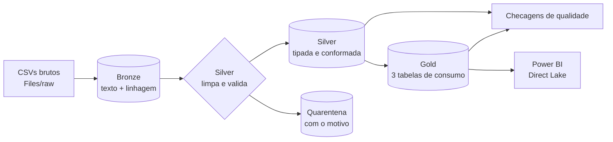

# fabric-medallion-starter

Ponto de partida para uma arquitetura **Medallion (Bronze → Silver → Gold)** no **Microsoft Fabric**, com **dados 100% sintéticos** de frequência escolar, testes automatizados e checagens de qualidade entre as camadas.

[](https://github.com/Victormartinsilva/fabric-medallion-starter/actions/workflows/ci.yml)


## A ideia

A lógica de cada camada fica em **funções puras** (entra DataFrame, sai DataFrame), testadas com pytest. Os notebooks do Fabric só fazem a entrada e a saída: leem do Lakehouse, chamam as mesmas funções e gravam em Delta. Assim dá para testar tudo no seu computador, sem workspace.



| Camada | O que faz | O que **não** faz |
|---|---|---|
| **Bronze** | Guarda o arquivo como chegou: tudo texto, com `_source_file` e `_ingested_at` | Não corrige, não filtra, não converte tipo |
| **Silver** | Normaliza texto, converte tipos, valida regras, remove duplicados. O que reprova vai para a **quarentena** com `motivo_rejeicao` | Não apaga nada sem explicar |
| **Gold** | Tabelas prontas para consumo, cada uma com o grão dito no nome | Não tem regra de limpeza |

## Os dados (fictícios)

Escolas, turmas, alunos e **frequência diária**. O gerador injeta defeitos de propósito para o pipeline ter o que tratar:

| Defeito injetado | Como a Silver trata |
|---|---|
| Registros duplicados (mesmo aluno e dia) | Mantém o primeiro, o resto vai para a quarentena |
| `status` inválido (`X`) | Quarentena: `status invalido` |
| `status` com caixa e espaços (`"p "`) | Normaliza para `P` |
| Data no futuro | Quarentena: `data futura` |
| Data impossível (`31/02/2025`) | Quarentena: `data invalida` |
| `aluno_id` vazio | Quarentena: `aluno_id nulo` |
| Aluno que não existe no cadastro | Quarentena: `aluno inexistente` |
| Nomes em maiúsculas e com espaços extras | Normaliza para `Nome Sobrenome` |

Regra de negócio: **75% de frequência mínima** (LDB, art. 24). Por padrão, falta justificada **não** conta como presença; dá para mudar com `justificada_conta_como_presenca=True`.

## Tabelas Gold

| Tabela | Grão | Pergunta que responde |
|---|---|---|
| `frequencia_mensal_turma` | turma × mês | Qual a taxa de presença de cada turma? |
| `frequencia_aluno` | aluno | Quem está abaixo dos 75%? (`em_risco`) |
| `resumo_escola` | escola | Como está cada escola, no geral? |

## Qualidade de dados

`quality.run_checks` devolve uma tabela com 12 regras (camada, tabela, regra, falhas, total, status). O pipeline **para com erro** se alguma falhar:

- **Silver:** chave `(aluno_id, data)` única, sem nulos, status em `P/F/J`, integridade referencial entre frequência, alunos, turmas e escolas.
- **Gold:** taxas entre 0 e 1, `presencas <= registros` e **reconciliação**: o total de registros do Gold bate com as linhas da Silver.

## Como rodar no seu computador

```bash
git clone https://github.com/Victormartinsilva/fabric-medallion-starter.git
cd fabric-medallion-starter
pip install -e ".[dev]"
pytest
python -m medallion.pipeline --base data
```

O pipeline gera `data/raw`, `data/bronze`, `data/silver`, `data/quarentena`, `data/gold` (em Parquet) e `data/qualidade.csv`.

## Como rodar no Microsoft Fabric

1. Crie um **workspace** e um **Lakehouse** (por exemplo `lh_medallion`).
2. No Lakehouse, em **Files**, envie a pasta `src/medallion` para `Files/medallion_src/medallion`.
3. Importe os 4 notebooks de [`fabric/`](fabric) (**Import → Notebook**) e anexe o Lakehouse como padrão em cada um.
4. Execute em ordem: `00_gerar_dados` → `01_bronze` → `02_silver` → `03_gold_e_qualidade`.
5. Crie um **modelo semântico em Direct Lake** sobre as tabelas `gold_*` e monte o relatório no Power BI.

Para automatizar, monte um **pipeline do Fabric** com as 4 atividades *Notebook* em sequência. Se a última falhar, a execução inteira falha.

### Status

- ✅ Lógica das 3 camadas, quarentena e checagens: **testada** (20 testes, CI em Python 3.11 e 3.12).
- ✅ Notebooks: as células rodam em sequência no teste `test_notebooks.py`, contra um Spark simulado em memória.
- ⚠️ Execução dentro de um workspace Fabric real: **ainda não validada**. O ponto mais provável de ajuste é o caminho `/lakehouse/default/Files` e a conversão pandas → Spark em `fabric.py`. Se rodar aí e encontrar algo, abra uma issue.

## Estrutura

```
src/medallion/
  generate.py   gera os CSVs sintéticos (com sujeira)
  bronze.py     texto + linhagem
  silver.py     limpeza, tipos, validação, quarentena
  gold.py       tabelas de consumo
  quality.py    checagens entre camadas
  rules.py      regras de negócio e motivos de rejeição
  fabric.py     gravação e leitura Delta no Lakehouse
  pipeline.py   orquestra tudo localmente (Parquet)
fabric/         notebooks do Fabric (00 a 03)
tests/          pytest
```

## Decisões de projeto

- **pandas, e não Spark, na lógica.** O volume típico de um cadastro escolar cabe em memória e o código fica testável em qualquer máquina. Para volumes grandes, a mesma estrutura de funções pode ser reescrita em PySpark sem mudar os contratos entre as camadas.
- **Quarentena em vez de descarte.** Linha rejeitada nunca some: fica numa tabela com o motivo, e a conta Bronze = Silver + quarentena é um teste.
- **Dados sintéticos.** Nenhuma informação real de pessoas, escolas ou municípios.

## Licença

[MIT](LICENSE)
